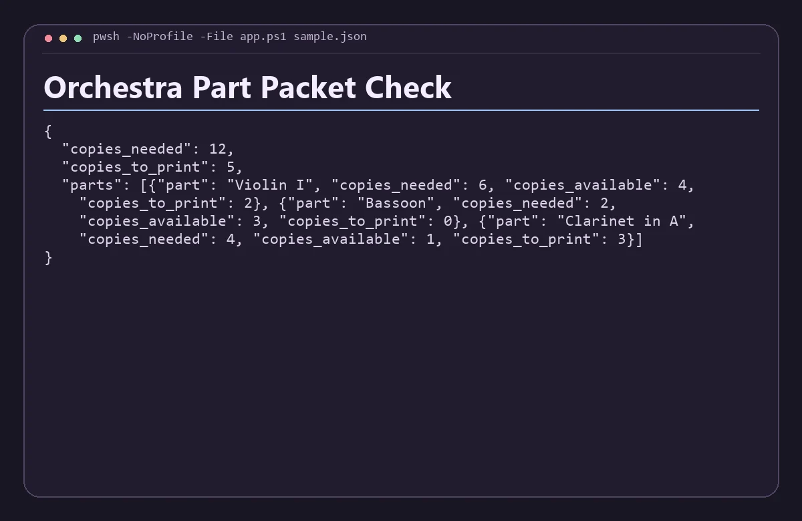

# Orchestra Part Packet Check

Build an orchestra print list from player counts, stand sharing, spare copies, and the parts already on hand.



## Run

Install PowerShell 7 or newer. Run these commands from the repository root.

```sh
pwsh -NoProfile -File app.ps1 sample.json
```

Replace `sample.json` with a JSON file following the same structure. The app prints a JSON report to standard output.

Enter each distinct part with its player count, players per copy, spare target, clean copies, and marked copies. Required copies are the player count divided by players per copy, rounded up, plus spares. Set allow_marked to true to count marked copies. Surplus copies of one part cannot cover a shortage of another part.

## Verify

Run `python check.py` with Python 3.11 or newer after the build step when applicable. The check verifies the bundled scenario and confirms that an invalid input returns an error.
